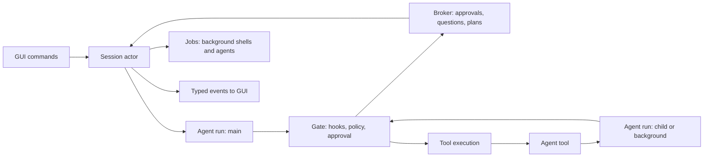

# Engine architecture

Status: active (v1.0.0). The crate layout and
dependency rules are in [AGENTS.md](../../AGENTS.md#crates); phase progress
is in [status](../status.md).

The model supplies judgment; the engine supplies authority, execution,
evidence and durability. Every executable capability (tools, MCP, hooks,
checks) goes through one gate, and every observable change is an event.

## Runtime model



- **Engine** (process-wide): paths, session store, model catalog, web client,
  a `ClientFactory` (tests inject a scripted model), an event sink
  (`Arc<dyn Fn(EventEnvelope)>`) shared by every session, at most one
  decision-model sidecar (`decisions/sidecar.rs`), shared by sessions with
  the same launch settings and stopped by `Engine::shutdown`, and the
  `NativeRuntime` (`decisions/native/`): one model download at a time and,
  with the `onnx` feature, the loaded native model sessions share.
- **Session**: `SessionCore` is shared state behind short-lived locks
  (settings, policy, transcript state, session log, broker, jobs, tools,
  and the `DecisionHub`: decision service, trace, shadow slots, and what
  the uses remember between seams).
  The **session actor** task owns the command channel and never blocks on
  the model or a tool: turns run in their own tasks and report back through
  an internal channel. Approvals, questions and plan reviews wait on the
  broker, so steering, mode changes and cancel keep working meanwhile.
- **Agent run**: one loop per agent (main or subagent), parameterized by an
  agent definition (prompt, tool filter, model, permission mode), a
  transcript sink (main: session log and state; subagent: its own
  `agents/<id>.jsonl`), a root directory (project or worktree), a depth,
  and a cancellation token.

Cancellation is a tree: session > turn > agent run > tool call. `Cancel`
and `Interrupt` cancel the foreground turn and its foreground subagents;
background jobs have tokens under the session and survive.

## One round of an agent run

1. Check cancellation, the per-run turn budget (`agents.max_turns`) and the
   session cost cap.
2. Relieve context pressure: above 50% of the window, clear old tool results
   (spilling originals to artifacts; the pressure decision seam may keep
   planned clears or add more, keeping wins); above
   `context.compact_at_percent`, summarize older history with the `fast`
   model (`PreCompact` hook first).
3. Build the request: cache-stable system sections (base prompt,
   environment, instructions, skills, output style), filtered tool specs,
   the working transcript, cache breakpoints on the last two user messages,
   thinking/effort, and pending reminders appended to the last user message.
   The request decision seam (`screen_request`) may first ask the user
   before likely credentials in new tool results are sent; withheld values
   become placeholders in this and every later request.
4. Stream the response: text/thinking deltas become events; `Retrying`
   becomes a `retrying` event; a context-overflow error forces compaction
   and one retry.
5. Record the assistant message and usage (per-agent and session cost from
   the catalog).
6. No tool calls: run the **stop boundary** (below). Otherwise execute the
   batch and append one user message holding every tool result (in call
   order), queued steering messages, and reminders (todo nudges, files
   changed externally, finished jobs, nested instructions).

Every `tool_use` always receives a `tool_result`, including on cancellation
("cancelled by user"), so a transcript is valid for any provider on resume.

### Tool batch

For each call, in order:

1. Unknown tool, malformed JSON or invalid input -> error result.
2. `PreToolUse` hooks (regex matcher on the tool name) may block, rewrite
   the input, or force allow/deny/ask.
3. `tool.action(input)` -> `policy.decide(tool, action, planning, mode)`
   (plan mode refuses state changes before the level is consulted):
   `Allow` runs; `Deny` returns the reason; `Ask` becomes an approval
   request. All asks in a batch are requested together; the GUI may answer
   them in any order. `AllowSession` adds a session rule; `AllowProject`
   also persists the rule to `.hyperform/settings.local.toml`; `Deny` returns
   the user's feedback to the model. Between the decision (policy plus any
   hook override) and the approval, the tool-gate decision seam
   (`review_call`) may only turn an `Allow` into an `Ask` with no rule to
   suggest or persist; it never allows, denies or changes an `Ask`.

Execution keeps call order: neighbouring calls that are concurrency-safe
run together; any other call is a barrier and runs alone. Each call emits
`toolStarted`, streamed `toolProgress`, and `toolFinished`, then runs
`PostToolUse` hooks (extra context or feedback is appended to the result)
and, unless the call was cancelled, the after-call decision seam, whose
notes are put ahead of the result as reminders.
Writes mark the run as mutated, refresh read tracking, and queue nested
`AGENTS.md`/rules reminders for newly touched directories.

### Stop boundary

When the model ends a response without tool calls:

1. `Stop` (main) or `SubagentStop` hooks may block with a reason; the run
   continues with that reason (at most 5 hook continuations per turn).
2. Steering messages that arrived meanwhile continue the run.
3. Main agent only, when files changed this turn: `verification.mode`
   `auto` runs the configured checks and feeds failures back; `strict`
   additionally continues until checks pass. Both are bounded by
   `verification.max_continuations`; `report` only computes the badge.
4. Main agent only, when verification is done: the stop decision seam may
   continue the run once per turn with a reminder
   (`MAX_DECISION_CONTINUATIONS`).
5. Otherwise the run ends. The turn records its outcome, usage, cost and
   verification badge (`Verified` / `Unverified` / `Failed` /
   `NotApplicable`).

### Decision seams

Experimental decision features (`decisions_*` in `[experimental]`) act only
at the seams in `decisions/seams/` (`Seam` in `decisions/registry.rs`):

| Seam | Called from | On advice |
|---|---|---|
| turn start | `session/turn.rs`, after `UserPromptSubmit` hooks | reminders in the opening message |
| context pressure | `run/pressure.rs` | keep or add planned clears; keeping wins |
| before a request | `run/agent.rs` | flag credentials for one approval |
| tool gate | `batch/gate.rs` | Allow becomes Ask (no rule to persist) |
| after a call | `batch/call.rs` | notes ahead of the result |
| stop boundary | `run/stop.rs` | one reminder per turn |
| ask user | `ports/interaction.rs` | a tool result instead of asking |
| route | `routing/start.rs`, `orchestration/launch.rs` | effort or model within what the task allows |
| completion | `verify/claims.rs` | a claim the verifier may act on |
| check select | `verify/modes.rs` | check ids to skip |
| relevance | `ports/relevance.rs` | which parts of a long result matter |
| turn end | `session/turn.rs`, in the background | the turn's tone |
| attention | `hooks/notify.rs`, `session/open.rs` | urgency per item |

A seam returns at once when no running use joins it. Shadow uses run
detached, at most four per session (extra ones skipped), and their advice
is dropped; `on` uses share a deadline of twice `decisions.timeout_ms`
plus 50 ms, and advice applies in `USES` order. Decisions only escalate:
no seam can allow, deny, cancel a turn or set a badge. Any model failure
abstains, so behavior equals Off (`decisions/seams/tests.rs`,
`tests/decisions_fallback.rs`; `tests/decisions_all_on.rs` and
`tests/decisions_shadow.rs` hold the safety rules with every feature On
or in Shadow). `USES` registers 21 uses, one per feature.

Their protocol surface: events `routeChosen { route }`,
`taskViewApplied { view }`, `completionClaimUnchecked { claim }`,
`suggested { suggestion }`, `suggestionResolved { suggestionId, accepted }`,
`turnToneJudged { turnId, tone }` and `urgencyScored { urgency }`;
commands `resolveSuggestion { suggestionId, accepted }` and
`includeFullHistory`. Only task views persist (below); the rest are live.
Details: [the decision layer](../how-it-works/features-experimental-and-decisions.md)
and [decision uses](../how-it-works/features-decision-uses.md).

## Tools contract (`hyperform-tools`)

```rust
#[async_trait]
pub trait Tool: Send + Sync {
    fn name(&self) -> &str;
    fn description(&self) -> String;        // from hyperform-prompts::tools
    fn input_schema(&self) -> Value;
    fn is_read_only(&self, input: &Value) -> bool;
    fn is_concurrency_safe(&self, input: &Value) -> bool;
    fn action(&self, input: &Value, ctx: &ToolCtx) -> Action;       // hyperform_policy::Action
    fn title(&self, input: &Value, ctx: &ToolCtx) -> String;        // "Edit src/main.rs"
    async fn preview(&self, input: &Value, ctx: &ToolCtx) -> Option<Preview>;
    async fn call(&self, input: Value, ctx: &ToolCtx) -> Result<ToolOutput, ToolError>;
}
```

`ToolCtx` is the per-call capability bundle: session/agent/call ids, root
directory and additional directories, the agent's persistent shell cwd,
a cancellation token, the agent's `FileTracker` (read-before-edit), shared
`PathLocks`, shell and environment policy, web client and options, a
progress sink, an artifact spill function, limits, whether the model has
vision, and `Ports`: engine services behind traits so tools never depend on
the engine:

- `AgentPort`: agent catalog, spawn (foreground/background/resume), apply a
  worktree agent's changes.
- `InteractionPort`: ask structured questions, propose a plan, update todos.
- `JobPort`: spawn a background shell, read job output, kill a job.
- `SkillPort`, `CheckPort` (list/run checks with evidence), `LspPort`,
  `McpPort` (call tools, list/read resources), `SideModelPort` (WebFetch
  extraction with the `fast` model).
- `WorkPort`: create, update, get and list tasks, record plan notes, and
  outline the plan behind `ExitPlanMode` ([work plans](#work-plans)).

## Subagents and jobs

- Definitions: built-ins (`general`, `explore`, `plan`, `review`, `verify`,
  and `audit` only while `work_plans` is On)
  shipped as markdown in `hyperform-prompts`, plus custom definitions from
  `.hyperform/agents` and `.claude/agents`. Tools are filtered by the
  definition; `AskUserQuestion` and `ExitPlanMode` are never given to
  subagents; `Agent` is removed at the depth limit.
- A subagent's permission mode is its definition's mode, else the parent's,
  except that a session in `bypass` overrides it at every tool call
  (`RunContext::mode`). Plan mode is separate and only ever added: a
  subagent plans when its definition says `plan`, its parent's spec plans,
  or the session plans (`RunContext::planning`), and bypass never lifts it.
  Its approvals appear in the GUI labelled with its agent id.
- Foreground agents return their final message (plus usage and changed
  files) as the `Agent` tool result. Background agents return a job id at
  once; completion queues a reminder for the parent. `resume` continues a
  finished agent from its stored transcript.
- `isolation: worktree` runs the agent in `.hyperform/worktrees/<agent>` on a
  new branch. At the end its changes are committed and summarized; the
  parent (`ApplyAgentChanges`) or the user (GUI) applies them with a
  three-way merge or discards them. A task-bound helper's apply or
  discard also goes to its plan task
  ([integration](v2-engine-work.md#integration)).
- Jobs unify background shells and background agents: `JobOutput` reads
  new output, `JobKill` stops, `jobUpdated` events feed the jobs panel.

## Persistence

`hyperform-store` keeps one directory per session: `log.jsonl` (records:
messages, turns, todos, plans, questions, approvals, agents, checks,
checkpoints, compactions, rewinds, mode/planning/model/title changes, usage,
task views), `meta.json`, `agents/<id>.jsonl`, and `artifacts/`. Replay rebuilds
the display transcript and the model's working set; a turn that started but
never finished is reported as `Interrupted`. A `TaskView` record
(`decisions_task_view`) stores the kept message ids in order plus the
index message, so replay rebuilds the same reduced working set; one with
`restored` set brings the full history back. `SessionSnapshot.task_views`
lists them for the GUI's dividers. v1 files are imported on
first open and left untouched. Work plans live outside the session, under
`plans/` ([work plans](#work-plans)).

Before each user turn the engine snapshots the working tree into a shadow
git repository (outside the project; captures shell-made changes). Rewind
restores code, conversation, or both to the state before any user message.

## Settings files

v2 reads `settings.toml` files and never modifies v1 `config.toml` files,
so a v1 build keeps working side by side. Layers, lowest first: defaults,
`~/.config/hyperform/settings.toml`, `<project>/.hyperform/settings.toml`,
`<project>/.hyperform/settings.local.toml` (gitignored), then environment
overrides. When a v2 file is missing, the v1 `config.toml` at that level is
imported: the user file is converted once into `settings.toml`; project
files are converted in memory and written to `settings.toml` only on the
first change made through the app.

## Hooks

Configured in settings (`[[hooks.<Event>]] matcher, command, timeout_secs`).
The command receives JSON on stdin (`session_id`, `transcript_path`, `cwd`,
`hook_event_name`, `permission_mode` (`plan` while planning, otherwise the
level), and event fields such as `tool_name`, `tool_input`,
`tool_response`, `prompt`, `stop_hook_active`). Exit 0 continues (stdout
becomes context for `UserPromptSubmit`/`SessionStart`); exit 2 blocks with
stderr as the reason; other codes warn. JSON stdout may set `decision`
(`block`/`approve`), `reason`, `continue: false` with `stopReason`, and
`hookSpecificOutput` (`permissionDecision`, `permissionDecisionReason`,
`updatedInput`, `additionalContext`).

**Workspace trust.** Until the user trusts a workspace, its project layers
may only restrict: `settings/effective.rs` takes hooks, MCP servers,
checks, the permission mode, allow rules, additional directories,
`auto_allow_read_only_bash`, and the whole `shell`, `provider`, `web`,
`lsp` and `decisions` sections from the user layer, while the project's deny and ask rules
and `permissions.planning` (plan mode only restricts) still apply. A
project agent definition cannot run looser than its caller
(`orchestration/blueprint.rs`), and a project command's `allowed-tools`
grant nothing (`commands/expand.rs`). Opening a session of an untrusted
project that sets any withheld category emits `trustRequired`;
`trustWorkspace { trusted: true }` records the root in `trust.json` and
reloads the session (`false` only dismisses the request). The categories
come from one function, `trust_gated`, which the settings screen also
reads through `Engine::trust_report` (`engine/queries/trust.rs`).

## Commands

`runCommand { name, args }` resolves against one catalog (`engine/src/
commands/`), first name wins: engine built-ins (`compact`, `context`,
`cost`, `status`, `remember`, `model`, `mode`, `effort`, `mcp`, `todos`,
`doctor`, `add-dir`, and `replan` while work plans are On), custom commands (discovery already layers project >
`.claude` project > user > `.claude` user; they may shadow a prompt built-in
but never an engine built-in), prompt built-ins
(`hyperform_prompts::commands::BUILTIN`), and MCP prompts of ready servers as
`mcp__<server>__<prompt>`. The GUI's own commands (`help`, `agents`, ...)
are listed by `Engine::slash_commands` with kind `ui` and never resolved.

- Engine built-ins answer without the model; informational ones emit
  `commandOutput { name, markdown }`. `/add-dir` extends the session policy
  (with `--save` also `permissions.additional_directories` in
  `settings.local.toml`).
- Prompt commands start a turn whose user message has two text blocks: the
  visible `/name args`, then the body in `<command name="name">…</command>`.
  Templates substitute `$ARGUMENTS` and `$1`..`$9` (shell-style words),
  inline `@path` files the policy lets the model read (256 KiB per file,
  1 MiB total), and run `` !`cmd` `` in the project root only when the
  command's `allowed-tools` or the session policy allow it. `allowed-tools`
  become session rules for that turn only; `model` overrides the model for
  that turn only. MCP prompt arguments map positionally or as `key=value`;
  missing required ones produce a notice instead of a turn.
- `@agent-<name>` of a known agent type adds a reminder to use the `Agent`
  tool with that `subagent_type`. Unknown commands get a notice with close
  matches.

## Context and memory

- **Instructions:** `~/.config/hyperform/AGENTS.md`, `AGENTS.md`/`CLAUDE.md`
  from the repository root down to the project, and `AGENTS.local.md` form
  the instructions section of the system prompt (later files take
  precedence). `AGENTS.md` files in subdirectories and glob-scoped rules
  (`.hyperform/rules/*.md` with `globs`) are injected as reminders the first
  time the agent touches a matching path; `alwaysApply` rules stay in the
  system prompt.
- **Prompt caching:** system sections are ordered for a stable prefix (base
  prompt, environment, instructions, skills, output style, repo map); the
  last cacheable section, the tool list and the last two user messages carry
  cache breakpoints (native on Anthropic, passthrough on OpenRouter).
- **Repo map:** a tree-sitter outline of Rust, TypeScript/JavaScript, Python
  and Go definitions, ranked by cross-file references and the files touched
  in the session, built off the request path and rebuilt only after a
  compaction or reload so the cached prefix stays stable.
- **Compaction:** above half the context window, old tool results are cleared
  (originals spilled to artifacts); above `context.compact_at_percent`,
  older history is summarized by the `fast` model. A split never separates a
  tool call from its result and may land inside a long single turn. For the
  main agent the summary job emits `compactionStarted { trigger: auto |
  manual }` once a split is planned, then `compacted { marker }`, or a
  warning notice if summarizing fails.

## Work plans

Experimental (`work_plans`, Off or On, and `work_parallel`, which
requires it); the work tools, `Agent { task_id }`, the `audit` agent and
`/replan` are offered only while `work_plans` is On. The pure kernel
`hyperform-work` decides every change and does no I/O; `PlanHub` keeps one
writer per plan; task-bound helpers run under a worker role, and their
worktree changes come back one at a time and are verified in the project
tree. One chat drives a plan at a time, and a plan resumes (interrupted
tasks, outside changes) whenever a chat opens or attaches it. The full
contract (kernel, storage, inputs and outputs, dispatch, integration,
parallel eligibility, the plan audit, held tasks, pause and resume, the
driving chat, and the re-evaluation after milestone 3) is in
[v2 engine architecture: work plans](v2-engine-work.md).

How it works in plain words: [work plans](../how-it-works/features-work-plans.md),
[parallel tasks and the plan audit](../how-it-works/features-work-parallel.md)
and [pausing, resuming and moving plans](../how-it-works/features-work-resume.md).

MCP and language servers, verification and the sandbox:
[servers, verification and sandbox](v2-engine-services.md).
