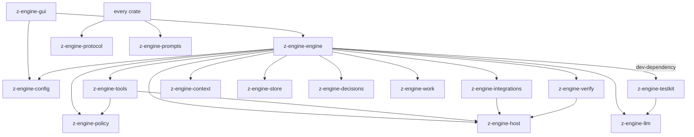

# The crates

HyperForm's Rust code is split into *crates* (Rust packages), each with one
job. This page explains each in plain words: what it owns, what it must not
do, its main modules and who uses it. Binding rules: the [structure contract](../../AGENTS.md#crates);
terms: the [glossary](glossary.md). Part of [How HyperForm works](README.md).

## How the crates fit together

**In plain words.** The crates are like departments of a company: a
dictionary and a script library everyone may consult, specialists that each
do one kind of work, one conductor that coordinates them, and a storefront
where the customer sits.

**How it works**
- Arrows mean "may import". Dependencies only point down, so a low crate
  never knows about a higher one.
- `z-engine-protocol` and `z-engine-prompts` are *leaf* crates: every crate
  may use them, and they use nothing.
- `z-engine-engine` is the only crate that knows the concrete
  implementations; `z-engine-tools` reaches engine services only through
  *capability traits* (ports).
- Only `z-engine-host` touches the operating system; `z-engine-integrations`
  owns its server processes, `z-engine-llm` makes the provider HTTP calls,
  `z-engine-decisions` sends the decision-model request (the native model
  is downloaded by host and run in process), and the GUI shell
  checks GitHub for updates, installs them, and opens project files
  through the opener plugin. `config` and `store` read and write only
  their own files; `context`, `policy` and `work` do no I/O at all.

**For developers**
- The graph matches each crate's `Cargo.toml`. Moving a responsibility
  updates this page (or [the engine, app and test crates](crates-engine-and-app.md)),
  the diagram and [AGENTS.md](../../AGENTS.md) together.

## z-engine-protocol

**In plain words.** The shared dictionary: the exact shape of every message
between the engine, the store and the window, like the standard forms every
office department fills in.

**How it works**
- Owns: ids (session, turn, agent, call, job, ...), the conversation model
  (messages and content blocks), `Command` (window to engine), `Event` and
  `EventEnvelope` (engine to window), snapshots, approvals, questions,
  todos, agents, jobs, usage and verification records, and the work-plan
  model (plans, tasks and their runs, helper reports, notebook entries,
  plan-log records, packets, audit findings, plan health, parallel sets).
- Every public type derives `ts_rs::TS`, so its TypeScript twin is
  generated into the frontend.
- Must not: do any I/O or depend on another HyperForm crate.

**For developers**
- [`src/`](../../crates/z-engine-protocol/src/): `commands.rs`, `events.rs`,
  `session.rs`, `content.rs`, `ids.rs`, `permission.rs`, `interaction.rs`,
  `agents.rs`, `jobs.rs`, `verification.rs`, `usage.rs`, `work/`.
- Used by every crate except prompts. After a change run
  `cargo test -p z-engine-protocol` and commit `ui/src/lib/protocol/`.

## z-engine-prompts

**In plain words.** The script cabinet: every word the model is told, kept
as markdown. The code reads its lines from here and never improvises its
own.

**How it works**
- Owns: all prompt prose under `prompts/<area>/*.md`: system prompts, tool
  descriptions, built-in agents, built-in prompt commands, reminders, and
  auxiliary prompts (compaction summary, titles, web extraction).
- Each file becomes one `pub const` (`include_str!`), compiled into the app.
- Must not: contain logic or depend on anything; no other crate inlines
  prompt text.

**For developers**
- [`prompts/`](../../crates/z-engine-prompts/prompts/): `system/`, `tools/`
  (one file per tool), `agents/` (explore, general, plan, review, verify,
  audit), `commands/` (commit, init, replan, review, security-review),
  `reminders/`, `auxiliary/`, `decisions/` (decision questions), `work/`
  (task packet, task list, helper brief, audit request). One module per area in [`src/`](../../crates/z-engine-prompts/src/);
  `agents.rs` and `commands.rs` hold the `BUILTIN` lists.
- Used by: context, tools, engine, decisions.

## z-engine-llm

**In plain words.** The switchboard to the AI providers: it dials the model
in each provider's language, streams the answer back, and redials when the
line is busy.

**How it works**
- Owns: the `ModelClient` trait (the one seam the engine calls), wire
  adapters (OpenAI chat completions, Anthropic Messages, OpenAI Responses),
  the GitHub Copilot client and device sign-in, streaming decoding, retries,
  fallback models, the model catalog and cost accounting.
- It sends the provider HTTP requests itself (including Copilot's sign-in
  and `/models`); tests plug in a scripted client instead.
- Must not: know about sessions, tools or the window; import anything but
  the leaf crates.

**For developers**
- [`src/`](../../crates/z-engine-llm/src/): `client.rs` (`ModelClient`),
  `anthropic/`, `openai/`, `responses/`, `copilot/`, `provider/` (detection,
  construction), `transport.rs`, `retry.rs`, `fallback.rs`, `accumulate.rs`,
  `catalog/`, `cost.rs`. Used by: engine, testkit.

## z-engine-config

**In plain words.** The receptionist who knows everyone's standing orders:
it reads the settings files in order, keeps your API keys and trusted
folders, and finds the agents, commands and instructions you wrote.

**How it works**
- Owns: settings layering (defaults, user, project, project-local,
  environment), import of v1 `config.toml`, targeted edits for the settings
  screens, credentials (`auth.json`), workspace trust, on-disk paths, the
  registry of [experimental features](features-experimental-and-decisions.md),
  and discovery of extensions (agents, commands, skills, rules, output
  styles) and instruction files (`AGENTS.md`).
- Loading never fails: a broken layer is skipped and reported.
- Must not: touch files other than its own; import anything but the leaf
  crates.

**For developers**
- [`src/settings/`](../../crates/z-engine-config/src/settings/) (one file
  per section, clamps in `normalize.rs`),
  [`default_config.toml`](../../crates/z-engine-config/src/default_config.toml),
  `loader.rs`, `merge.rs`, `writer.rs`, `migrate/`, `credentials.rs`,
  `trust.rs`, `paths.rs` (with `plans_dir`), `extensions/`, `instructions.rs`, and
  [`features/`](../../crates/z-engine-config/src/features/) (`FeatureId`,
  `FeatureMode`, `FEATURES`; `Settings::feature` in `settings/experimental.rs`).
- Types export to `ui/src/lib/protocol/config/`. Used by: engine, gui.

## z-engine-policy

**In plain words.** The rulebook the security guard consults: given "this
tool wants to do this", it answers allow, ask or deny. It reads rules; it
never opens a door itself.

**How it works**
- Owns: permission modes, allow/ask/deny rules and their syntax, the
  decision pipeline for file access, command execution and the sandbox, and
  static analysis of shell commands (pipelines, read-only commands, the
  files a command touches).
- A tool describes its call as an `Action`; the policy decides.
- Must not: do any I/O; paths are compared as text.

**For developers**
- [`src/`](../../crates/z-engine-policy/src/): `action.rs` (`Action`),
  `engine.rs` (the policy), `rules/`, `decide/`, `shell/`, `paths.rs`.
- Used by: tools, engine (which builds the policy from settings in
  `z-engine-engine/src/settings/policy.rs`).

## z-engine-host

**In plain words.** The only pair of hands that touches the computer:
files, commands, search, git and web pages all go through it. Everyone else
asks the hands.

**How it works**
- Owns: file access (atomic writes, locks, read tracking), processes and
  background shells (with process-tree kill), the optional command sandbox
  (macOS seatbelt, Linux bubblewrap), search (ripgrep or a built-in engine,
  globs, fuzzy file search), git (status, worktrees, patches), code
  checkpoints in a shadow git repository, web fetch and search, workspace
  fingerprints, and the resumable, checksum-verified model download.
- Must not: know about sessions, models or permissions; import anything but
  the leaf crates.

**For developers**
- [`src/`](../../crates/z-engine-host/src/): `fs/`, `process/`, `sandbox/`,
  `search/`, `git/`, `checkpoint/`, `web/`, `media.rs`, `fingerprint.rs`,
  `net.rs` (the sidecar's free port), `download.rs` (`.part` resume).
- Used by: tools, integrations, verify, engine.

## z-engine-integrations

**In plain words.** The interpreter on a conference call with outside
helpers: MCP servers (extra tools) and language servers (code intelligence)
all speak JSON-RPC, and this crate speaks it back.

**How it works**
- Owns: one JSON-RPC core; MCP clients over stdio and streamable HTTP
  (tools, resources, prompts, list-changed notifications); multi-server LSP
  clients (navigation, symbols, diagnostics, rename previews).
- The documented exception to "only host touches the OS": it starts and
  owns its long-lived server processes and speaks HTTP to MCP servers; the
  environment policy and process-tree teardown come from host.
- Must not: import anything but host and the leaf crates.

**For developers**
- [`src/`](../../crates/z-engine-integrations/src/): `jsonrpc/`, `mcp/`,
  `lsp/`, `process/`.
- Used by: engine, whose `src/mcp/` and `src/lsp/` run them per session.

## z-engine-context

**In plain words.** The assistant who packs the model's briefcase: what goes
into each request (instructions, environment, reminders, a map of the code)
and what to summarize when the briefcase is too full.

**How it works**
- Owns: the layered system prompt ordered for prompt-cache stability,
  cache breakpoints, `<system-reminder>` blocks, instruction rendering, the
  tree-sitter repo map, token estimates, the `/context` breakdown,
  compaction and task-view planning, and the final pass that shapes messages the way
  every provider accepts.
- Must not: do I/O; callers pass file contents in.

**For developers**
- [`src/`](../../crates/z-engine-context/src/): `system.rs`, `sections.rs`,
  `environment.rs`, `instructions.rs`, `reminders.rs`, `cache.rs`,
  `repo_map/`, `tokens.rs`, `breakdown.rs`, `compaction/`, `wellformed.rs`,
  `work/` (task packet, task list, helper brief, coordinator reminder and
  audit request text).
- Used by: engine.

## z-engine-verify

**In plain words.** The inspector with a clipboard: it finds the project's
tests and builds, runs them when asked, and writes down the evidence,
without ever stopping you from finishing.

**How it works**
- Owns: read-only discovery of checks (Cargo, npm/pnpm/yarn/bun, Python,
  Go, Gradle, Maven, .NET, CMake, Make, just, Deno), running one check
  through the host shell into a `CheckRecord`, test-count parsing, choosing
  checks for changed paths, and the per-turn badge.
- Must not: decide whether work may end; import anything but host and the
  leaf crates.

**For developers**
- [`src/`](../../crates/z-engine-verify/src/): `discovery/` (with
  `ecosystems/`), `parse/` (one parser per test runner), `run.rs`,
  `select.rs`, `narrow.rs` (check selection), `assess.rs`, `artifact.rs`, `spec.rs`.
- Used by: engine (`src/verify/` holds the modes).

## z-engine-store

**In plain words.** The ship's logbook: every session is written down line
by line as it happens, and can be read back to resume it.

**How it works**
- Owns: one directory per session with `log.jsonl` (append-only records),
  `meta.json` (listing cache), `agents/<id>.jsonl` (subagent transcripts)
  and `artifacts/` (spilled outputs, check logs, images); replay into the
  state a session resumes from; import of v1 transcripts; the opt-in
  decision dataset (`decisions/dataset/<question>.jsonl`); work-plan logs
  (`plans/<project key>/<plan id>/events.jsonl` and `meta.json`).
- Must not: touch files outside its sessions, plans and dataset
  directories; import anything but the leaf crates.

**For developers**
- [`src/`](../../crates/z-engine-store/src/): `store.rs` (`SessionStore`),
  `log.rs`, `append.rs`, `record.rs`, `replay.rs`, `meta.rs`, `heal.rs`,
  `listing.rs`, `artifacts.rs`, `dataset.rs` (`DecisionDataset`),
  `plans/` (`PlanStore`), `legacy/`. Used by: engine.

## z-engine-decisions

**In plain words.** The quick second opinion: it puts short, typed
questions to a small local model and hands back an answer only when the
model is sure, otherwise "keep today's behavior".

**How it works**
- Owns: typed questions and answers, the `DecisionProvider` seam (rules,
  SystemOne for laya-serve or Jev, `onnx` for the native runtime behind the
  `onnx` Cargo feature, hybrid), pinned native models, calibration, cache, probe, trace.
- A documented network exception: it sends the `POST /v1/systemone`
  request itself. The sidecar and the model download are the engine's.
- Must not: know about sessions, settings or seams; import anything but
  the leaf crates.

**For developers**
- [`src/`](../../crates/z-engine-decisions/src/): `question.rs`,
  `answer.rs`, `provider.rs`, `providers/` (with `onnx/`),
  `native_model.rs`, `calibration.rs`, `cache.rs`, `probe.rs`, `trace.rs`.
  Used by: engine. More: [the decision layer](features-experimental-and-decisions.md#the-decision-layer).

## z-engine-work

**In plain words.** The clerk of the work plans: it knows who may change
what, which status may follow which and when a task counts as done, and
checks every proposed change against those rules without touching a file.

**How it works**
- Owns: the task graph, the task and plan state machines, folding a plan
  log into its state, authority per role (including the worker role of a
  task-bound helper), the completion gate, follow-ups (a failed or
  replaced task blocks its dependents; a plan with every task closed is
  Done; every revision is audited), task packets cut to a budget, plan
  depth, reconciliation findings and the tasks they hold, dispatch and
  parallel eligibility, helper reports, interrupted tasks and their
  resume pointers, what needs you, the deterministic audit and plan
  health.
- `decide` returns the records to append, or a rejection naming every
  reason; the engine supplies the facts and does the writing.
- Must not: do I/O; import anything but the leaf crates.

**For developers**
- [`src/`](../../crates/z-engine-work/src/): `proposal.rs`, `authority.rs`,
  `transitions.rs`, `kernel/`, `state/`, `graph.rs`, `scope.rs`, `packet/`,
  `depth.rs`, `reconcile.rs`, `held.rs`, `dispatch.rs`, `parallel.rs`,
  `resume.rs`, `needs.rs`, `audit.rs`, `health.rs`, `why.rs`, `error.rs`.
  Used by: engine. More: [work plans](features-work-plans.md),
  [parallel tasks and the plan audit](features-work-parallel.md),
  [pausing, resuming and moving plans](features-work-resume.md).

## z-engine-tools

**In plain words.** The toolbox: every action the model can take (read,
edit, run a command, search, ask, send a helper) is one labelled tool with
an input form and a safety card.

**How it works**
- Owns: the `Tool` trait, the per-call `ToolCtx`, the ordered registry, one
  file per built-in tool, MCP tools named `mcp__server__tool`, and shared
  cores (the edit engine, format-specific reading, notebooks, diffs).
- Each tool turns its input into a policy `Action` and can preview its
  effect; the engine's gate decides, then calls it.
- Must not: import the engine. Engine services come through ports
  (`AgentPort`, `InteractionPort`, `JobPort`, `SkillPort`, `CheckPort`,
  `LspPort`, `McpPort`, `SideModelPort`, `WorkPort`); the OS only through
  host.

**For developers**
- [`src/`](../../crates/z-engine-tools/src/): `tool.rs`, `context/`,
  `ports/`, `registry.rs`, `names.rs`, [`builtin/`](../../crates/z-engine-tools/src/builtin/)
  (one file per tool; `list.rs` registers them), `mcp_tool.rs`, `edit/`,
  `reading/`, `notebook/`, `text/`.
- Used by: engine. Tool list: [core features](features-core.md).

The engine, the desktop app and the test kit, which put these crates
together, are on [The engine, app and test crates](crates-engine-and-app.md).
Which files to touch for a common change (a tool, a setting, a command, an
event, a work-plan rule): [Where do I change X?](where-to-change.md).

See also: [How HyperForm works](README.md) · [The desktop app](features-desktop-app.md) · [v2 engine architecture](../architecture/v2-engine.md) · [AGENTS.md](../../AGENTS.md)
