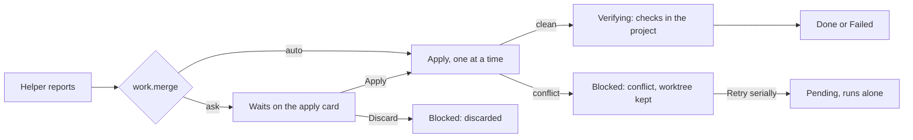

# Parallel tasks and the plan audit

How a [work plan](features-work-plans.md) hands its tasks to helpers, how
the experimental `work_parallel` feature runs independent tasks at the
same time and brings their changes back, and how the plan audit and plan
health show what the plan misses. How to use them:
[Work plans](../user-guide/18-work-plans.md) and
[Plan mode with work plans](../user-guide/05-plan-mode-questions-and-todos.md#plan-mode-with-work-plans).
Terms are in the [glossary](glossary-experimental.md).

## Helpers on tasks

**In plain words.** The foreman can give one job card to a helper. The
helper gets the card and a form to fill in at the end, works only on that
job, and can't rewrite the rest of the folder.

**How it works**
1. While `work_plans` is On, the `Agent` tool takes a `task_id`. Only the
   main agent may use it, and only for a task that is pending and ready
   (not held by you or by a plan change), not owned by another agent, and
   with attempts left. With `resume` too, it may only continue the helper
   an [interrupted task](features-work-resume.md#resuming-a-plan)'s
   pointer names. The kernel's refusal starts with "Task t2 cannot be
   dispatched:" (or "cannot be resumed:") and lists every reason. While `work_plans` is Off the
   field isn't in the tool's schema, so a `task_id` sent anyway is
   ignored: an ordinary helper runs and no task is bound.
2. A second task-bound helper while one runs needs `work_parallel` in
   effect and the plan's parallel work approved; then at most
   `work.max_parallel` helpers (capped by `agents.max_concurrent`) run at
   once. A task started beside a running task must pass the
   [parallel check](#which-tasks-run-together) and gets its own worktree;
   once parallel work is approved every task-bound helper gets one, so
   helpers sent in the same round never share the project folder. If no
   worktree can be made, the helper stops before it runs.
3. The helper's first message is its brief: the task packet, then how to
   work (stay in scope, only this task, record notes, run `Verify`, send
   the report before ending; in a worktree, report and end instead of
   completing). The packet emits `taskPacketSent` with reason `dispatch`,
   and again with `compaction` after the helper's own compaction.
4. Binding records a `taskDispatched` event: the task becomes Active,
   owned by the helper, with its attempt counted. The helper's role is
   *worker*: it may change its own task only (status, criteria, steps,
   evidence notes, dependencies, report), create subtasks of it only as
   Proposed, and record notes. Plan changes stay with the main agent, the
   *coordinator*.
5. Attempts: agents may start a task `work.max_attempts` times. Your
   **Retry** (and **Retry serially**) forgives the attempts used so far,
   so the task gets a fresh budget; a start that was interrupted
   ([soft stop](features-work-resume.md#pause-hold-and-stop)) is forgiven
   too.

**For developers**
- Kernel: [`dispatch.rs`](../../crates/hyperform-work/src/dispatch.rs)
  (`check`, `budget`, `parallel_reason`), `kernel/run_ops.rs` (dispatch,
  report, integrate, retry), the worker role in `authority.rs`.
- Engine: `work/dispatch.rs` (`admit`, the helper-busy and cap
  refusals), [`orchestration/task_run.rs`](../../crates/hyperform-engine/src/orchestration/task_run.rs)
  (`admit`, `bind`, `settle`), `work/helper.rs` (`save_report`,
  `conclude`, `integrate`), `work/inject.rs` (`helper_packet`); the brief
  is `prompts/work/helper.md` (`helper_brief` in `hyperform-context`).
- The tool's side: `AgentTool::with_tasks` in
  `hyperform-tools/src/builtin/agent.rs`; `AgentInfo.taskId` names the task
  on the Agents tab and the Agent card.

## Which tasks run together

**In plain words.** Two crews can work at once only if nothing they touch
overlaps and neither waits for the other. Lockfiles and generated files
are touched by almost everyone, so a job that names one works alone.

**How it works**
1. Parallel work needs three things: `work_parallel` in effect (it
   requires `work_plans`; alone it stays Off with a warning), the plan's
   parallel policy **approved** (only you set it: **Build with helpers in
   parallel**, or **Allow helpers in parallel** while building), and the
   session out of plan mode.
2. A candidate is excluded beside another running or chosen task when:
   either must run alone (you chose **Run alone**, or it was retried
   serially), either names no files, either names a `work.serial_paths`
   glob, a dependency path links them, or their files or symbols
   overlap. A free slot under `work.max_parallel` is needed too. While
   findings replan the plan, the tasks they hold are excluded ("it is
   held until the plan change is accepted"); the others stay eligible.
3. Candidates are taken in ready order (priority, then tree order) and
   cut to the free slots. When the agent starts several helpers in one
   batch, the engine admits them one at a time under a per-plan lock, in
   call order, so each check sees the helpers admitted before it. The result is the *parallel set*: eligible
   tasks, excluded tasks each with its reason, running tasks and the
   maximum.
4. The Plan tab asks for the set: a Draft gets a preview (plan mode,
   policy and status ignored) for "*N* tasks can run together"; a
   building plan gets the live set for the row badges.

**For developers**
- [`hyperform-work/src/parallel.rs`](../../crates/hyperform-work/src/parallel.rs):
  `eligible`, `preview`, `beside_running`, `describe` (the refusal text
  per `ParallelBlock`, `Replanning` for a held task).
- Settings: `WorkSettings` in `hyperform-config/src/settings/work.rs`
  (`max_parallel`, `merge`, `serial_paths`, `DEFAULT_SERIAL_PATHS`) and
  `Settings::max_parallel_tasks`; the feature's prerequisite in
  `features/registry.rs` (`requires`).
- The `work_parallel` query (`Engine::work_parallel`, `engine/queries/work.rs`);
  the badges in `ui/src/lib/domain/work/parallel.ts`.

## The result contract

**In plain words.** The helper hands in a form, and HyperForm staples its
own receipts to it: which files really changed and which checks really
ran. The helper's own lists are kept, but marked as its word.

**How it works**
1. The helper sends `TaskUpdate { report }`: a summary, files and symbols
   changed, discoveries, decisions, experiments, tests run, blockers,
   follow-ups, risks and a confidence (low, medium or high). It is kept
   until the run ends (a later one replaces it); one sent with
   `completed` is recorded at once, and a `completed` without a report
   takes the saved one, so a saved report counts however the run ends.
2. When the run ends, the report is folded with what HyperForm observed:
   the files `git diff --name-only` shows between the worktree's base and
   branch (unknown when git can't tell), and the checks the helper ran.
   The helper's own files and tests are kept as *claims*. A report from a
   run that read the web is marked from the web.
3. No report: the task is Blocked ("ended without a report", in the
   model's text and the Plan tab alike) and waits for your **Retry** or
   **Not needed**. A task without a result takes the summary as its
   result.

**For developers**
- `ReportDraft`, `TaskReport`, `ReportClaims`, `ReportSource` in
  `protocol/src/work/report.rs`; `RunFacts` and the fold in
  `kernel/run_ops.rs`; the schema in `hyperform-tools/src/builtin/task_update.rs`.
- The GUI's **Result**: `TaskResult.svelte` with `resultView()`,
  `integrationLine()`, `attemptLine()` in `ui/src/lib/domain/work/report.ts`.

## Bringing changes back

**In plain words.** Each crew's work is checked in at the front door one
at a time. If it doesn't fit, nothing in the house is touched and the
crew's copy stays outside until you decide.

**How it works**
1. When a reporting helper's run ends: no worktree, or one that changed
   nothing, counts as applied at once; otherwise `work.merge` decides.
   `ask` (the default) records `pendingApply` and shows the Agents tab's
   apply card. `auto` applies at once under the session's merge lock; if
   that fails, a notice says "Could not apply agent … 's changes" and it
   waits as with `ask`. An untrusted project's `auto` is ignored.
2. **Applied**: the task becomes Verifying and each check kind its
   criteria name runs once in the project tree, recorded as the helper's
   checks and linked as evidence. The completion gate then gives Done,
   Failed ("the integration check *label* failed in the project tree"),
   or leaves it Verifying while other criteria wait. A check that can't
   run posts "Task …'s integration check did not run: …". Checks the main
   agent runs in the project tree (`Verify`, or the automatic checks at
   its stop boundary) also link to every Verifying task with a check
   criterion of that kind, and the gate runs again. For a Verifying task
   with a check criterion still pending or with stale evidence, the Plan
   tab offers **Run checks again** (`recheckTask`): the kernel confirms
   the task is Verifying and its checks run again as after a merge.
3. **Conflict**: the project is left untouched, the worktree is kept, and
   the task is Blocked with the conflicting paths. **Retry serially**
   resets the run (fresh attempts, `serial` so it runs alone) and removes
   the kept worktree; applying the kept worktree after you fix it moves
   the task on to Verifying.
4. **Discard**: the task is Blocked ("its change was discarded") until
   you retry it.
5. Opening a session only prunes git's records of worktrees whose folder
   is gone; nothing on disk is deleted, so a task's worktree stays until
   it is applied, discarded or retried serially.
6. An [interrupted task](features-work-resume.md#resuming-a-plan)'s
   worktree is kept for its resume pointer. The Agents tab shows that
   helper as "Interrupted · kept for task …" with **Discard** only: Apply
   is refused ("This helper's work belongs to task …. Resume the task or
   discard its work."), and Discard removes the worktree from the pointer
   (`resumeWorktreeDiscarded`), so the next run starts clean.

**For developers**
- `settle`, `apply`, `discard`, `drop_kept` in `orchestration/task_run.rs`;
  `changed_files`, `apply` (merge lock, conflicts) in
  `orchestration/worktree.rs`; `verify_merged` and `recheck` in
  [`work/merged.rs`](../../crates/hyperform-engine/src/work/merged.rs),
  `link_check` in `work/evidence.rs`;
  `orchestration/recover.rs` on open.
- `Integration` (`pendingApply`, `applied`, `conflict`, `discarded`) on
  `TaskRun` in `protocol/src/work/run.rs`; `BlockReason::MergeConflict`,
  `ChangeDiscarded`, `Unreported`.

## The coordinator

**In plain words.** After each crew reports, the foreman is told what
came back and which jobs can start now.

**How it works**
1. After each outcome (ended, no report, waiting to apply, conflict,
   discarded, verified, check failed, still verifying, or stopped by a
   pause or a hold) the main agent gets a reminder: "Helper *id* on task
   *t*: *what happened*. The task is now *status*.", the report's
   summary, newly ready tasks, those that may run in parallel now, and
   those held until the plan change is accepted. It is told to dispatch
   ready tasks with `Agent` and `task_id` (adding `resume` to continue an
   interrupted one), several at once only from the parallel list, and to
   leave held tasks alone.
2. The plan is then reconciled, as after a discovery.
3. A Failed or Replaced dependency blocks its open dependents; they
   unblock once it is done or cancelled, or the dependency is removed.

**For developers**
- [`work/coordinate.rs`](../../crates/hyperform-engine/src/work/coordinate.rs)
  (`News`, `tell_coordinator`), `prompts/reminders/work-coordinate.md`;
  the phrases in `hyperform-context/src/work/coordinate.rs`; propagation in
  `kernel/propagate.rs`.

## Scope drift

**In plain words.** A helper hired for the kitchen who wants to repaint
the hall has to ask first, and the plan notes that it asked.

**How it works**
1. A task-bound helper's `Edit`, `Write` or `MultiEdit`, or a shell
   redirect the policy can attribute, to a path outside its task's
   declared scope is *scope drift*.
2. The gate escalates it: an Allow becomes an Ask with "This helper works
   on task t2 and would write outside the task's declared scope: …"; a
   Deny stays a Deny; Bypass mode doesn't ask.
3. Each such path is noted once on the task as a kernel discovery
   ("helper for t2 tried to write outside its scope: *path*"), before
   the write is allowed or denied.

**For developers**
- [`work/drift.rs`](../../crates/hyperform-engine/src/work/drift.rs)
  (`outside_scope`, `Drift`), called from `batch/gate.rs` before
  `review_call`; `escalate` in `decisions/seams/`.

## The plan audit

**In plain words.** An inspector reads the plan, not the code, and lists
what would make it fail: requirements nobody covers, checks the project
can't run, risky changes without a test.

**How it works**
1. **Deterministic**: after every accepted revision the kernel audits the
   plan and records the findings only when they change. Kinds:
   uncovered requirement and criterion without a method (high), risky
   path without a test (high: `**/migrations/**`, `**/migrate/**`,
   `**/*.sql`, `**/schema*`, `**/protocol/**`, `**/*.proto`,
   `**/store/**`, `**/persistence/**` and `work.sensitive_paths`, with no
   test criterion or migration step), task without criteria, risk
   without a mitigation and overlap (medium), duplicate (low).
2. Ids are stable (for example `taskWithoutCriteria:tsk_1`), so a
   dismissal sticks; a finding no longer found is resolved, and one found
   again after being resolved reopens.
3. **The `audit` agent** (read-only, Review model, offered only while
   `work_plans` is On; a custom agent of that name replaces it). The
   engine's own audit is one model request without tools, with the plan
   as JSON (document cut to 8,000 characters, at most 40 notebook
   entries); it answers with at most 20 findings, recorded as *review*
   findings (medium unless it says otherwise; references the plan
   doesn't have are dropped). It runs when `ExitPlanMode` proposes a plan
   whose depth is *deep*, and on **Run audit**. The depth is assessed
   again from all open tasks at `ExitPlanMode` and when you approve: Deep with eight or more tasks, scopes in five or more
   folders, or a scope touching `work.sensitive_paths`. Its findings
   never resolve on their own. Sent as a helper, the same agent has
   `Read`, `Glob` and `Grep` and may check the plan against the code;
   its prompt covers both. A failure posts "The plan audit did not
   finish: …"; an asked-for audit that found nothing, "The plan audit
   found nothing to add."
4. **Add to plan** marks the finding added and creates a Pending task
   (your own) from its suggestion, linked to its requirements and files;
   the main agent is told to address it. **Dismiss** is yours only.

**For developers**
- [`hyperform-work/src/audit.rs`](../../crates/hyperform-work/src/audit.rs)
  (`audit`, `RISKY_PATHS`), `kernel/audit_ops.rs` (`follow_up`,
  `upserts`); `AuditFinding` in `protocol/src/work/audit.rs`.
- Engine: [`work/audit.rs`](../../crates/hyperform-engine/src/work/audit.rs)
  (`review_deep_plan`, `request`, `parse`), `work/findings.rs` (Add to
  plan); prompts `agents/audit.md`, `work/audit-request.md`,
  `reminders/work-finding-added.md`.

## Plan health

**In plain words.** A one-line health report on the folder's cover: how
much is covered, how good the proof is, and how many problems wait.

**How it works**
- Counted from the plan state: requirements and how many have a task
  with criteria, tasks, done tasks, tasks without criteria, blocked and
  failed tasks, evidence (Good when every criterion of every done task is
  met with none waived, Poor when a done task has no criteria or a failed
  one, Fair otherwise or with nothing done), stale evidence, open
  findings, reconciliation findings and unmitigated risks.
- The header shows counts and levels only, never percentages; evidence
  appears once a task is done.

**For developers**
- [`hyperform-work/src/health.rs`](../../crates/hyperform-work/src/health.rs);
  `PlanHealth` in `protocol/src/work/health.rs`; `coverageLine()` in
  `ui/src/lib/domain/work/health.ts`.

## Storage and protocol

**In plain words.** The new forms go into the same logbook as the rest of
the plan.

**How it works**
- New plan-log events: `taskDispatched`, `taskReported`,
  `taskIntegrated`, `taskRetried` (`serial`, `freshAttempts`), `audited`
  and `findingStatusChanged`.
- New Plan-tab edits: `approveParallel`, `addFinding`, `dismissFinding`,
  `requestAudit`, `retrySerially`, `acceptTask` (**Run one task at a
  time** sends `setParallel` off).
- The snapshot and `workUpdated` carry `audit` and `health`; each task
  carries its `run` (dispatch, integration, report, forgiven attempts,
  serial).
- Pausing and resuming add `taskInterrupted` (with the task's `resume`
  pointer) and `resumeWorktreeDiscarded`, the edit `releaseTask`,
  `replanHeld` in the snapshot and `workUpdated`, the
  plan-change cause `resume`, and the `PlanSummary` fields `blocked`,
  `needsYou`, `running`, `lastSessionId` and `attachedTo`
  ([pausing, resuming and moving plans](features-work-resume.md)).

**For developers**
- Protocol: `run.rs` (`TaskRun`, `TaskDispatch`, `Integration`),
  `report.rs`, `audit.rs`, `health.rs`, `parallel.rs` (`ParallelSet`,
  `ParallelBlock`) in [`protocol/src/work/`](../../crates/hyperform-protocol/src/work/mod.rs).
- Contract details: [v2 engine architecture: work plans](../architecture/v2-engine-work.md).

See also: [Work plans](features-work-plans.md) ·
[Pausing, resuming and moving plans](features-work-resume.md) ·
[Agents and context](features-agents-and-context.md) ·
[The desktop app's screens](features-desktop-screens.md) ·
[Crates](crates.md)
