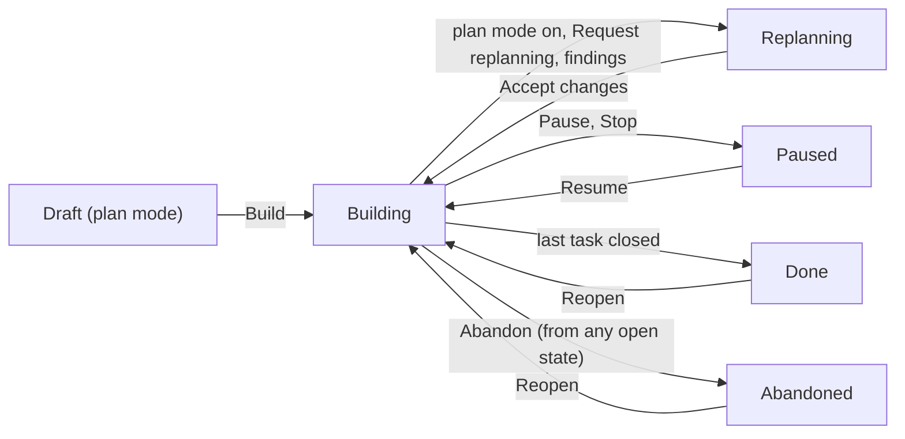

# Work plans

How the experimental `work_plans` feature keeps a chat's work as a plan
of tasks that outlives the conversation: what a plan holds, who may change
it, when a task counts as done, what the model is given about its task,
and how the plan is checked against the workspace. How to use it:
[Work plans](../user-guide/18-work-plans.md) and
[Plan mode with work plans](../user-guide/05-plan-mode-questions-and-todos.md#plan-mode-with-work-plans).
How features are tried: [Experimental features and graduation](features-experimental-and-decisions.md#experimental-features-and-graduation).
Helpers on tasks, parallel tasks, the plan audit and plan health:
[Parallel tasks and the plan audit](features-work-parallel.md). Pausing,
holding, resuming after a restart and moving a plan between chats:
[Pausing, resuming and moving plans](features-work-resume.md).
Terms are in the [glossary](glossary.md).

## The plan and its kernel

**In plain words.** A work plan is the project's job folder: the goal, the
rules that must not break, a task list with a checklist per task, and a
notebook of what was decided and learned. A strict clerk keeps the folder.
Anyone may hand the clerk a change, but the clerk files only changes that
follow the rules and says exactly why it refused the others.

**How it works**
1. The feature is Off or On; it has no Shadow mode (Shadow stays Off with
   a warning). While it is Off, nothing below happens and requests are the
   same as without the feature.
2. A plan belongs to a project. A chat has at most one *attached* plan,
   and one chat at a time *drives* a plan: attaching it in another chat
   moves it there ([one chat drives a plan](features-work-resume.md#one-chat-drives-a-plan)).
3. A plan holds a goal, a markdown document (the plan you reviewed),
   requirements and invariants, a tree of tasks, and notebook entries:
   design decisions, discoveries, experiments, evidence and changes of
   plan. A task has a title, a description, a kind, dependencies on other
   tasks, a scope (files or globs), acceptance criteria, steps and a
   result.
4. Every change is a *proposal*. The pure kernel decides it against the
   current state: who is asking, which status may follow which, and the
   gates below. An accepted change is appended to the plan log, applied,
   and announced; a refused one changes nothing and returns every reason
   ("cognition proposes, the kernel disposes").

| Who | May |
|---|---|
| You (the Plan tab, Build) | approve the plan, accept proposed requirements and invariants, accept or dismiss proposed tasks, waive a criterion, confirm a criterion you check yourself, confirm or dismiss notebook entries, allow parallel work, retry a task with fresh attempts, add or dismiss audit findings, pause, resume, stop, abandon and reopen the plan, hold and release a task |
| The main agent (the *coordinator*) | create, edit, start, complete and cancel tasks, set criteria, mark inspection criteria met, record notebook entries, send helpers for tasks |
| A helper sent for a task (a *worker*) | change its own task only (status, criteria, steps, evidence notes, its report), propose subtasks of it, record notes ([helpers on tasks](features-work-parallel.md#helpers-on-tasks)) |
| Another subagent | read the plan and record decisions, discoveries and experiments |
| The engine | link check results as evidence, mark check criteria met, record reconciliation and audit findings, bring a helper's change back, put an interrupted task back with a resume pointer, link checkpoints |
| A turn that read web content | add tasks, notes, requirements and invariants that wait for you, and report progress; it can't change what the plan already says ([below](#web-content-waits-for-you)) |
| Compaction summaries | record discoveries only, which stay unconfirmed until you confirm them |

**For developers**
- [`z-engine-work`](../../crates/z-engine-work/src/lib.rs) is pure (no
  I/O): `proposal.rs` (`Proposal`, and `From<WorkEdit>` for Plan-tab
  edits), `authority.rs` (`Role`, `admit`), `transitions.rs` (the task
  and plan state machines), `kernel/` (`decide`, the completion gate in
  `gate.rs`), `state/` (`PlanState::fold` over the log), `graph.rs`,
  `packet/`, `reconcile.rs`, `held.rs` (what a replan holds), `needs.rs`
  (what needs you), `resume.rs` (interrupted tasks) and `error.rs`
  (`Reason`, `Rejection`).
- The engine's side is [`work/`](../../crates/z-engine-engine/src/work/mod.rs):
  `PlanHub` (`hub.rs`) keeps one live `PlanHandle` per plan for the whole
  process, so each log has one writer; `PlanHandle::submit` (`plan.rs`)
  decides, appends and syncs, applies, writes `meta.json` and emits
  `workUpdated` to every watching session.
- The tools' side is `WorkPort` ([tools](../../crates/z-engine-tools/src/ports/work.rs),
  [engine](../../crates/z-engine-engine/src/ports/work.rs)); tool input
  becomes proposals in `work/proposals.rs`.

## Web content waits for you

**In plain words.** Anything the agent read on the internet during a turn
could have been planted there. So the clerk puts what that turn hands in
on a "waiting for you" tray, marked *from web*: new tasks and notes are
kept, but nothing the plan already says changes until you agree.

**How it works**
1. A run *has read the web* from the moment a `WebFetch` or `WebSearch`
   result comes back until the run ends; your next message starts clean.
   A helper started by such a run starts the same way. A helper whose run
   read the web passes it on to the run that gets its report: at once for
   a foreground helper, and for a background one when its output is read
   with `JobOutput`. A helper that read the web is remembered as such, so
   resuming it later (even after a restart) starts its run, and the
   caller's once the report comes back, the same way. The "finished"
   reminder for a background helper carries only its description and
   status, so it passes nothing on. A `PlanRecord` whose `source` is a
   URL counts too, for that record.
2. Every work change from such a run reaches the kernel as untrusted
   input: `TaskCreate`, `TaskUpdate`, `PlanRecord`, the goal, document,
   requirements and invariants of `ExitPlanMode`, and the `TodoWrite`
   steps.
3. What it adds waits for you, marked **from web**. A new task in a
   Building or paused plan is **Proposed**: no one can start it until you
   **Accept** it in the Plan tab (or **Dismiss** it). In a Draft or a
   Replanning plan it keeps its normal status, because **Build** or
   **Accept changes** approves it with the rest. Decisions, discoveries,
   experiments and evidence notes are unconfirmed (a note for a criterion
   doesn't count toward it), and requirements and invariants are proposed.
4. It can't change what the plan already says: a task's title,
   description, criteria, scope or dependencies, moving, cancelling or
   replacing a task, rewording or retiring a requirement, and the goal and
   document once the plan is approved. The refusal tells the agent that
   you can make the change in the Plan tab. Tasks proposed from web content
   stay editable until you accept them.
5. Progress goes through the normal gates: starting and completing tasks,
   a task's result, confirming inspection criteria, the `TodoWrite` steps,
   handing an accepted task to a helper (never a proposed one), retrying a
   task alone where the agent already may, and a helper's report. That
   report's discoveries, decisions and experiments are marked **from
   web** (unconfirmed). Integrating a helper's change, audits and audit
   findings stay with HyperForm and you.
6. Only you accept a task proposed from web content; the agent can't, not
   even in a later turn. An accepted task keeps its **from web** mark.
   **Build** and **Accept changes** never accept proposed tasks.
7. Web content that arrives another way, such as `curl` run with `Bash`
   or an MCP tool's result, doesn't count as reading the web.

**For developers**
- The taint is `WebTaint` ([`run/web.rs`](../../crates/z-engine-engine/src/run/web.rs))
  on `RunContext`, set in `batch/call.rs` when a `WebFetch` or `WebSearch`
  call returns. Helpers inherit it in `orchestration/launch.rs`; a
  foreground report passes it back in `orchestration/spawn.rs`, a
  background one through `JobHub::read_web` when `JobOutput` reads it
  (`ports/jobs.rs`). `AgentInfo.readWeb` records it on the helper, and
  `launch.rs` starts a resumed helper from it. The work, jobs and
  interaction ports set `Facts.untrusted_input` from it.
- The kernel's role is `Role::Untrusted(Provenance::Research)` next to the
  actor's `Role::base` (a researching helper keeps its task scope). The
  coarse gate is `admit_research` in `authority.rs`, the edit limits are
  [`kernel/research.rs`](../../crates/z-engine-work/src/kernel/research.rs),
  and a new task's status and provenance are set in `kernel/task_ops.rs`.
  `Task.provenance` and `TaskReport.provenance` load as `agent` from older
  logs (a report's is set in `kernel/run_ops.rs`); the Plan tab's Accept
  is `WorkEdit::AcceptTask`.

## From plan mode to building

**In plain words.** Plan mode drafts the job folder; **Build** signs it
off. If the site changes under you, the folder goes back to review before
anyone starts a new task.

**How it works**
1. The main agent starts a plan with its first `TaskCreate`, or with
   `ExitPlanMode` and a `goal` (that tool takes `goal`, `requirements` and
   `invariants` while the feature is On). In plan mode the plan is a
   **Draft**; otherwise it is Active (**Building**) at once. Requirements
   and invariants the agent writes are *proposed*.
2. In a Draft no task can start ("the plan is draft"). **Build** approves
   it: proposed items become active, your edited document replaces the
   plan's, the plan becomes Active and plan mode turns off; with no turn
   running the GUI sends "Build the attached plan." **Build in a new
   chat** approves with `handoff`, so this chat ends its turn without
   implementing, and a new chat in the project attaches the plan and gets
   its full task packet.
3. A Building plan goes to **Replanning** when you turn plan mode on, pick
   **Request replanning**, or reconciliation finds a problem. Each records
   a *plan change* with its cause; every later change until approval is
   grouped under it. When you asked for it, no task starts; when findings
   did, only the tasks they name and their dependents are *held*
   ([below](#reconciliation-and-replan)). **Accept changes** makes the
   plan Active again.
4. Attaching and detaching are session-log records (`planAttached`,
   `planDetached`). Reopening a chat reattaches its plan unless another
   chat drives it now; rewinding the conversation doesn't change which
   plan is attached. Detaching keeps the plan on disk.
5. A Building plan becomes **Done** by itself when its last open task is
   done or not needed. Pausing, stopping, abandoning and reopening:
   [pause, hold and stop](features-work-resume.md#pause-hold-and-stop).

**For developers**
- `ensure` and the attach commands in [`work/attach.rs`](../../crates/z-engine-engine/src/work/attach.rs);
  `approve`, `planning_on`, `edit` and `replan` in
  [`work/lifecycle.rs`](../../crates/z-engine-engine/src/work/lifecycle.rs),
  called from `control::resolve_plan` and `control::set_planning`.
- `PlanDecision::Approve { mode, edited_plan, handoff }`; commands
  `editWork { planId, edit }`, `attachPlan { planId }`, `detachPlan`. The
  GUI's `buildPlan` in `ui/src/lib/runtime/actions.ts` chains them.

## Tasks, criteria and the completion gate

**In plain words.** A task is done when its checklist is ticked with
receipts, not when someone says so. A passing test counts only if it ran
on the code as it is now.

**How it works**
1. `TaskUpdate` moves a task: `in_progress` starts it, `completed` asks
   for Done, `blocked` and `failed` need a reason, `deleted` cancels it
   (shown as **Not needed**). A task starts only when it is ready: every
   dependency done and the plan Building. Agents may start one task at
   most `work.max_attempts` times; your **Retry** gives it a fresh budget.
2. Each acceptance criterion says how it is shown to hold: a check of a
   kind (`test`, `build`, `lint`, `typecheck`, `format`, `custom`), an
   inspection the agent may mark met, or a check you make yourself. Only
   you confirm your own checks and waive criteria.
3. Every recorded check run (the `Verify` tool, or the checks the
   [verification mode](features-integrations-and-safety.md#verification)
   runs) is linked by the engine to the matching check criteria of the
   task that agent started, with the workspace
   [fingerprint](glossary.md#fingerprint) after the run: a pass marks the
   criterion met, a failure marks it failed. Commands run with `Bash` are
   not evidence.
4. **The gate.** Done needs every criterion that isn't waived to hold (a
   check criterion: the latest linked check of its kind on the current
   tree passed), every subtask closed and every dependency done. A refusal
   names each gap, for example "needs a passing test check on the current
   tree: the latest check ran on an older tree".
5. While an agent works on a task, its `TodoWrite` list is saved as the
   task's steps.
6. The kernel follows up on its own: when a task fails or is replaced,
   the open tasks that wait on it become blocked, and they unblock once it
   is done or not needed, or the dependency is removed; changing a done
   task's scope or criteria reopens it; a Building plan whose tasks are
   all closed becomes Done; and every accepted revision is
   [audited](features-work-parallel.md#the-plan-audit).

**For developers**
- [`kernel/gate.rs`](../../crates/z-engine-work/src/kernel/gate.rs)
  (`completion`, `check_gap`), [`kernel/status.rs`](../../crates/z-engine-work/src/kernel/status.rs),
  `kernel/propagate.rs` and [`transitions.rs`](../../crates/z-engine-work/src/transitions.rs).
- [`work/evidence.rs`](../../crates/z-engine-engine/src/work/evidence.rs):
  `link_check` (called from `verify/record.rs`) and `record_steps` (from
  `TodoWrite`); the attempt limit is in `work/proposals.rs`.

## Task packets and compaction

**In plain words.** Before each stretch of work the agent gets a briefing
sheet for its task, sized to fit, so a long chat or a summary never makes
it forget what it is doing.

**How it works**
1. **The pin**: every turn start adds a short reminder with the plan's
   goal, status and revision, the task the agent works on and the next
   ready one.
2. **The packet**: the full briefing for the main agent's focus task (the
   one it started, else the next ready task). It goes out the first time,
   when the focus task changes, after a compaction, and when the plan is
   reattached (a reopened chat or a new chat that builds); a new plan
   revision alone doesn't resend it. `TaskGet` returns the same packet on
   demand. A helper sent for a task gets that task's packet in its brief,
   and again after its own compaction.
3. The goal, active invariants, the task's requirements, the task with its
   criteria, its parent, blockers and scope always fit. Then, while
   `work.packet_tokens` allows: dependencies with their results, the
   latest evidence per criterion (marked stale when the tree changed), and
   notebook entries ranked by link (this task, a parent, a dependency,
   shared files, then unlinked recent ones). What didn't fit is counted.
4. **Compaction**: the summary request is told that the plan lives
   outside the conversation and asked for at most ten confirmed facts as
   a `json` block. Those become unconfirmed discoveries, and the packet is
   appended to the summary message (the divider then says "plan
   restored").
5. The [repository map](features-agents-and-context.md#the-repository-map)
   ranks the files in the focus and active tasks' scopes right after the
   files the agent touched.
6. Each packet the engine sends emits `taskPacketSent` with its token
   count and reason. The Context tab's **Task packet** rebuilds the latest
   one (or a task's, opened from its detail) from the current plan, section
   by section, with why each entry made it in.

**For developers**
- Selection: [`z-engine-work/src/packet/`](../../crates/z-engine-work/src/packet/mod.rs)
  (`select`, `rank.rs`); text: [`z-engine-context/src/work/`](../../crates/z-engine-context/src/work/mod.rs)
  with `prompts/work/packet.md`, `reminders/work-pin.md` and
  `work-packet.md`.
- Sending: [`work/inject.rs`](../../crates/z-engine-engine/src/work/inject.rs)
  (`pin`, `due_packet`, `focus_files`) and `work/session.rs` (`take_due`);
  compaction in [`work/compaction.rs`](../../crates/z-engine-engine/src/work/compaction.rs)
  with `auxiliary/compact-work.md`. GUI: the `work_packet` query and
  `overlays/InspectorPacket.svelte`.

## Reconciliation and /replan

**In plain words.** Now and then someone walks the building site with the
plan in hand. If a wall the plan relies on is gone, the plan goes back for
review, and the crew working next to that wall waits; the rest of the site
carries on.

**How it works**
1. Reconciliation runs at a turn start when the workspace fingerprint
   changed since the last one, after a discovery about an open task,
   when a task's helper ends or its change comes back, when a plan
   [resumes](features-work-resume.md#resuming-a-plan) with files changed
   outside it, and on `/replan`.
   It needs no model: the kernel compares the plan with the files.
2. It finds: scope files that were deleted, a done task whose evidence no
   longer holds (files in its scope changed, or its check went stale), a
   dependency that failed or was replaced, open tasks with no order
   between them whose scopes overlap, and open tasks with the same title.
   Changed and deleted files are those the diff since the session's last
   code checkpoint shows (`Facts.changed_since`); a scope path that
   doesn't exist yet, such as a file its task will create, isn't a
   deletion. A task finished after that
   checkpoint isn't compared with them, so a task's own edits never make
   its evidence stale. The trade-off: an outside edit made in the same
   turn right after a task completes isn't flagged.
3. New findings are recorded; a Building plan goes to Replanning with a
   plan change ("Reconciliation found N problem(s) with the plan"), and
   the main agent gets a reminder to revise the affected tasks. Only you
   return the plan to Active (**Accept changes**). A finding that still
   stands isn't reported again; no new findings: nothing is recorded and
   nothing is sent.
4. **A failure holds only what it affects.** When findings moved the
   plan to Replanning, only the tasks they name and their dependents are
   held: they don't start or run in parallel, and their packets say the
   plan is replanning. Every other ready task keeps running. Accepting
   the plan change, or the findings resolving, releases them. Replanning
   you started (plan mode on, **Request replanning**, `/replan` with only
   your text) still holds every task.
5. `/replan [what to reconsider]` (listed only while the feature is On)
   reconciles at once, counting every current finding. With none and no
   text it answers "The plan matches the workspace, so there is nothing
   to replan." With findings, the plan goes to Replanning as in step 4;
   with only your text, it goes there as your request. Then a turn asks
   the agent to revise the tasks without changing code and to ask you to
   accept the changes.

**For developers**
- Findings: [`z-engine-work/src/reconcile.rs`](../../crates/z-engine-work/src/reconcile.rs)
  (`ReconcileFinding` in `protocol/src/work/finding.rs`). The hold:
  [`held.rs`](../../crates/z-engine-work/src/held.rs) (`partial`,
  `replan_held`), `Readiness::ReplanHeld` and `WorkSnapshot.replanHeld`. Triggers:
  [`work/reconcile.rs`](../../crates/z-engine-engine/src/work/reconcile.rs);
  the command: `work/replan.rs`, `WORK_COMMANDS` in `commands/catalog.rs`,
  prompts `commands/replan.md` and `reminders/work-reconcile.md`.

## Storage and protocol

**In plain words.** Each plan is its own logbook beside the chats, so it
survives the chat that made it and can be read back exactly.

**How it works**
- A plan is a folder `plans/<project key>/<plan id>/` in the data folder
  (the project key is the one its code checkpoints use): `events.jsonl`,
  one record per line (sequence, revision, time, actor, cause, event), and
  `meta.json`, the plan's summary (`PlanSummary`: goal, status, task
  counts, `blocked`, `needsYou`, `running`, `lastSessionId`), written
  atomically after each accepted change.
- Refused proposals are logged as `rejected` audit records. Opening a log
  cuts a half-written last line and skips damaged ones. If a write fails,
  the plan turns read-only until it is opened again.
- The window gets the attached plan in the session snapshot (`work`:
  plan, tasks, entries, findings, audit findings and health) and each
  accepted revision as `workUpdated` (changed parts only). What helpers,
  parallel runs and the audit add:
  [storage and protocol](features-work-parallel.md#storage-and-protocol).

**For developers**
- Store: [`z-engine-store/src/plans/`](../../crates/z-engine-store/src/plans/mod.rs)
  (`PlanStore`, `PlanLog`, `PLAN_SCHEMA`; a newer schema is refused); the
  folder: `plans_dir` in `z-engine-config/src/paths.rs`; the key:
  `project_key` in `z-engine-host/src/checkpoint/shadow.rs`.
- Protocol [`work/`](../../crates/z-engine-protocol/src/work/mod.rs):
  `plan.rs`, `task.rs`, `ledger.rs`, `record.rs` (`WorkRecord`,
  `WorkEvent`), `edit.rs` (`WorkEdit`), `packet.rs`, `finding.rs`,
  `view.rs` (`WorkSnapshot`, `WorkUpdate`, `WhyStep`), and `run.rs`,
  `report.rs`, `audit.rs`, `health.rs`, `parallel.rs`; ids `pln_`,
  `tsk_`, `ent_`.
- GUI queries in [`engine/queries/work.rs`](../../crates/z-engine-engine/src/engine/queries/work.rs):
  `work_plans`, `work_packet`, `work_why` (a task's history for
  **Why?**) and `work_parallel` (the parallel set), behind
  `src-tauri/src/commands/work.rs`.

See also: [Parallel tasks and the plan audit](features-work-parallel.md) ·
[Interaction features](features-interaction.md) ·
[Agents and context](features-agents-and-context.md) ·
[Crates](crates.md) · [v2 engine architecture](../architecture/v2-engine.md)
